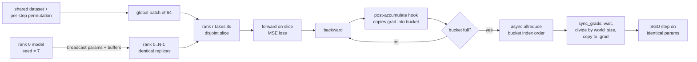

# Data Parallel DDP From Scratch

`DistributedDataParallel` is a broadcast plus an allreduce plus an optimizer
step. This module builds that pattern from the collectives up:

- rank 0 broadcasts the initial parameters and buffers, so every replica starts
  byte-identical;
- each rank runs forward/backward on its own slice of one global batch;
- a post-accumulate backward hook on every parameter fills reverse-order
  gradient buckets;
- a full bucket launches an asynchronous gloo allreduce immediately, overlapping
  communication with the remaining backward pass;
- `sync_grads()` waits, divides the summed gradient by `world_size`, and writes
  the mean gradient back into `param.grad`;
- `SGD` then steps every replica in lockstep.

The module also implements `no_sync()` gradient accumulation and a
`find_unused_parameters` path for branchy forwards. A deterministic
single-process reference trains the same model on the same global batches so
the distributed run can be checked step by step.

The spec is the [AI Engineering From Scratch data-parallel DDP capstone](https://aiengineeringfromscratch.com/learn/capstone-projects/data-parallel-ddp).
Everything runs locally on CPU; no external service is simulated.

## Architecture



### Broadcast at construction

`DistributedDataParallel.__init__` records a SHA-256 of the model state, calls
`torch.distributed.broadcast(..., src=0)` for every parameter and buffer, then
re-hashes. The test that builds each rank with `seed + rank` proves the
broadcast is real: pre-broadcast hashes differ, post-broadcast hashes are all
the same as rank 0's original state. With the default shared init seed the
hashes already match, which is the advertised backup behavior.

Buffers are synchronized at construction. The MLP's `output_scale` buffer is
part of the state hash; a model with changing buffers (for example BatchNorm
running statistics) would need a per-forward buffer broadcast, which this
teaching module does not implement.

### Mean, not sum

Every path runs an allreduce with `ReduceOp.SUM` and then divides by
`world_size`. That is why the test suite can train the same model at world
sizes 2 and 4 and get the same parameters as a single-process run. A
sum-without-divide implementation would be off by a factor of `world_size`.

### Buckets and overlap

`plan_buckets` walks `Model.parameters()` in reverse, because gradients become
ready in roughly that order during backward. Parameters are packed until the
next one would exceed `bucket_cap_mb`; a parameter larger than the cap gets its
own bucket. The default 25 MiB cap intentionally produces one bucket for the
tiny MLP, matching the spec's lesson. A small cap (`0.004` MiB) produces three
buckets and exposes the mechanism.

Each bucket owns one contiguous flat buffer. When the last parameter in a
bucket receives its post-accumulate gradient, the hook copies it into the flat
buffer and launches `dist.all_reduce(..., async_op=True)`. Buckets are launched
strictly in bucket-index order, not readiness order: every rank must enter
collectives in the same sequence or gloo can hang. `sync_grads()` waits for the
handles, divides the flat buffer, and scatters it back to `param.grad`.

The naive baseline skips hooks and buckets entirely and issues one synchronous
allreduce per parameter after backward. The benchmark table below compares the
two on the same model and data.

### `no_sync()` and accumulation

`no_sync()` is a re-entrant context manager that suppresses the hooks while
gradients accumulate in `.grad`. The first backward after the context exits
launches the reductions for the accumulated gradients. The reference loop
accumulates the same number of global microbatches before its one optimizer
step, so `no_sync` correctness is checked against a single-process baseline
rather than a prose claim.

### Unused parameters

`find_unused_parameters=True` does not install eager hooks. `sync_grads()`
scans `.grad` after backward, zero-fills the buckets, reduces every bucket in
index order, and writes back only parameters that actually received a
gradient. Unused parameters keep `grad=None`, so SGD skips them. This avoids the
missing-gradient deadlock without an autograd graph walk; the cost is that
overlap is disabled in this mode. Without the flag, a missing gradient raises a
clear error instead of hanging, after waiting for already-launched collectives.

### Deterministic data and reference

One fixed dataset and one fixed per-step permutation define a global batch.
Each rank deterministically takes a contiguous, disjoint slice of that batch.
The sequential reference takes the whole global microbatches in the same order.
With equal shard sizes, the average of the rank-local mean gradients equals the
full-batch mean gradient. The default verification dtype is `float64` because
it drives reduction-order noise down to roughly `5e-17`.

The wrapper implementation lives in `code/main.py` as the spec requests. Tests
and spawned workers import it through `data_parallel_ddp.main`, a loader that
avoids a top-level package named `code` (which would shadow Python's stdlib
`code` module). `torch.multiprocessing.spawn` starts one process per rank; each
process initializes gloo with a fresh file-based rendezvous inside a unique
temporary directory.

## Quickstart

Requires Linux, Python 3.14, and [uv](https://docs.astral.sh/uv/). PyTorch is
pinned to the CPU build so the setup does not download CUDA packages.

```bash
cd 77-data-parallel-ddp
uv sync --frozen
uv run python code/main.py
```

Expected: a 20-step table with every row `PASS`, byte-identical replicas, and
`ALL CHECKS PASSED`. Run the full gate with:

```bash
./verify.sh
```

`verify.sh` synchronizes the pinned environment into the ignored `.venv`,
compiles the Python sources, and runs the 16-test pytest suite. It is safe to
run twice: the second run reuses the environment and the tests use unique
temporary rendezvous directories.

Useful variants:

```bash
# Prove the constructor broadcast overwrites rank-specific initialization.
uv run python code/main.py --init-jitter --steps 0 --world-size 2

# Force three gradient buckets and show async launches during backward.
uv run python code/main.py --steps 4 --world-size 2 --bucket-cap-mb 0.004

# Accumulate three microbatches before one sync/step.
uv run python code/main.py --batch-size 96 --no-sync-microbatches 3

# A branchy forward that leaves fc2 unused.
uv run python code/main.py --find-unused --no-use-hidden
```

## What runs offline and what is real

Everything after the first dependency sync runs offline:

- the rendezvous is a `FileStore` in a local temporary directory;
- gloo is the real CPU backend and the allreduce moves real tensors between
  real OS processes;
- the reference is a real single-process training loop over the same data;
- hashes are computed from the actual parameter bytes, not from loss proxies;
- tests make no external network calls and require no GPU, cloud sandbox, paid
  API, or remote host.

There is no fake allreduce or mocked process group behind the measurements.
The only network access in the whole workflow is `uv sync`, which downloads the
pinned wheels. The benchmark numbers describe local CPU gloo, not an NVIDIA
fabric.

## Measured results

Measured locally on a 12-vCPU x86_64 Linux host, Python 3.14.10, PyTorch
2.15.0+cpu, gloo CPU backend, four spawned ranks. The exact host line from the
run is:

```text
torch=2.15.0+cpu python=3.14.10 cpus=12 platform=Linux-7.3.5-2-cachyos-x86_64-with-glibc2.44
```

### Correctness: 20 steps, four ranks, one bucket

```text
step   ref_loss   ddp_loss     dloss       ref_sum       ddp_sum      dsum   max|dw| replicas result
----------------------------------------------------------------------------------------------------------------
   0   0.609808   0.609808  0.00e+00    6.87875154    6.87875154  0.00e+00  1.39e-17    exact PASS
   1   0.408441   0.408441  5.55e-17    6.88363562    6.88363562  0.00e+00  2.78e-17    exact PASS
   2   0.539473   0.539473  0.00e+00    7.00278417    7.00278417  0.00e+00  2.78e-17    exact PASS
   3   0.494653   0.494653  5.55e-17    7.08279546    7.08279546  0.00e+00  2.78e-17    exact PASS
   4   0.466215   0.466215  5.55e-17    7.22347991    7.22347991  0.00e+00  2.78e-17    exact PASS
   5   0.487751   0.487751  5.55e-17    7.32943873    7.32943873  0.00e+00  2.78e-17    exact PASS
   6   0.460595   0.460595  0.00e+00    7.49733602    7.49733602  0.00e+00  2.78e-17    exact PASS
   7   0.457120   0.457120  5.55e-17    7.70729931    7.70729931  0.00e+00  2.78e-17    exact PASS
   8   0.550232   0.550232  0.00e+00    7.99562789    7.99562789  8.88e-16  5.55e-17    exact PASS
   9   0.391609   0.391609  5.55e-17    8.16559823    8.16559823  0.00e+00  5.55e-17    exact PASS
  10   0.417340   0.417340  5.55e-17    8.43755601    8.43755601  0.00e+00  5.55e-17    exact PASS
  11   0.521479   0.521479  0.00e+00    8.80108330    8.80108330  0.00e+00  5.55e-17    exact PASS
  12   0.363998   0.363998  5.55e-17    9.04883722    9.04883722  0.00e+00  5.55e-17    exact PASS
  13   0.302216   0.302216  0.00e+00    9.28367203    9.28367203  0.00e+00  5.55e-17    exact PASS
  14   0.249399   0.249399  2.78e-17    9.58240248    9.58240248  0.00e+00  5.55e-17    exact PASS
  15   0.257501   0.257501  5.55e-17    9.94722384    9.94722384  1.78e-15  5.55e-17    exact PASS
  16   0.213511   0.213511  2.78e-17   10.17099760   10.17099760  1.78e-15  5.55e-17    exact PASS
  17   0.173667   0.173667  0.00e+00   10.46905564   10.46905564  1.78e-15  5.55e-17    exact PASS
  18   0.187873   0.187873  0.00e+00   10.70506265   10.70506265  1.78e-15  5.55e-17    exact PASS
  19   0.134223   0.134223  5.55e-17   10.95696429   10.95696429  0.00e+00  5.55e-17    exact PASS

buckets=1 params=6 param_bytes/rank=11016
allreduce calls/step=1.00 bytes/step=11,016 overlapped launches/step=1.00
worker train_s=0.165 wall_s=3.206 sync_s=0.025
max loss delta=5.551e-17 max param delta=5.551e-17 broadcast_ok=True pre_hashes_differ=False
loss first=0.609808 last=0.134223
ALL CHECKS PASSED
```

The `ref_sum`/`ddp_sum` columns are scalar parameter checksums; `max|dw|` is
the maximum absolute parameter difference from the single-process reference
across all ranks. Every rank's parameter hash matched every other rank exactly
at every step (`torch.equal`, not tolerance). Reference equivalence is
`5.551e-17` in `float64`; it is not asserted bitwise because sharded autograd
and gloo allreduce use different summation orders. The spec's byte-equality
language is satisfied across DDP replicas, where the allreduce result is
identical; the sequential reference is compared at float epsilon.

### Broadcast proof

With `--init-jitter --steps 0`, each rank starts from `seed + rank`; the
constructor broadcast repairs it:

```text
broadcast pre hashes:  ['a7fa67888bf0', '527f134591ef']
broadcast post hashes: ['a7fa67888bf0', 'a7fa67888bf0']
broadcast proof: rank-specific initial state differed before broadcast
ALL CHECKS PASSED
```

### Bucket fusion and overlap

Command:

```bash
uv run python code/main.py --benchmark --steps 20 --world-size 4 --bucket-cap-mb 0.004
```

The table uses medians of three consecutive runs on the same host; the ranges
are the three measured `train_s` values, not estimates:

```text
mode        allreduce/step   bytes/step  buckets  overlap/step   train_s   max|dw| result
----------------------------------------------------------------------------------------
naive                 6.00       11,016        0          0.00     0.243  5.55e-17 PASS
bucketed              3.00       11,016        3          3.00     0.197  5.55e-17 PASS

naive vs bucketed max|dw|=5.551e-17
ALL CHECKS PASSED
```

Three runs produced naive `0.231–0.246 s` and bucketed `0.189–0.198 s`. The
model is tiny and the transport is CPU gloo, so the measured 1.23x is a
property of this host and this run, not a general DDP speedup claim. The
structural result is deterministic: six synchronous allreduces per step drop to
three asynchronous bucket allreduces, all three launched from backward hooks
before `backward()` returned. The naive path has zero overlapped launches.

### Tests

```text
16 passed in 32.15s
```

The suite covers constructor broadcast, per-step reference equivalence, world
size 2 versus 4 mean invariance, bucket planning and coverage, fused reductions
and hook launches, naive-versus-bucketed agreement, `no_sync` accumulation,
branchy `find_unused` forwards, the world-size-1 no-collective path, config
validation, and both CLI entry points. Tests spawn real gloo processes; no test
uses a network service.

## Optional real GPU / NCCL mode

The wrapper calls backend-agnostic `torch.distributed.broadcast` and
`all_reduce`; the model, buckets, and gradients are ordinary torch tensors. A
CUDA build can run the same code path with:

```bash
uv run python code/main.py --device cuda --backend nccl
```

The worker moves the model and microbatch tensors to the per-rank CUDA device
and initializes NCCL instead of gloo. This path exists in the code but is not
exercised by the CPU-only pinned wheel, so no GPU throughput or NCCL numbers
are claimed. A multi-node run would replace the local `FileStore` rendezvous
with a shared-filesystem path or a TCPStore; the gradient algorithm and tests
would not change.

## Limitations

- **CPU gloo only measured.** No NCCL, NVLink, multi-node, or GPU numbers are
  reported. The 1.23x bucket result is a small local measurement, not a fabric
  benchmark.
- **Reference equivalence is float64 epsilon, not bitwise.** Rank replicas are
  byte-identical; the sequential reference differs in the last bits because
  the reduction order differs.
- **`find_unused_parameters` is the safe, simple variant.** It scans `.grad`
  after backward and therefore disables overlap. Production DDP traverses the
  autograd graph before backward and can keep overlap while skipping unused
  parameters.
- **Not every production DDP feature is present.** There is no `static_graph`,
  `gradient_as_bucket_view`, mixed precision, uneven-input `join`, activation
  checkpointing, or per-forward buffer synchronization.
- **Synchronization is explicit.** Call `sync_grads()` after `backward()` and
  before `optimizer.step()`; the wrapper does not finalize inside `backward`.
- **Homogeneous parameters only.** All trainable parameters must share one
  dtype and device. The model is a small MLP, not a transformer.
- **Checks are Python-level.** `verify.sh` runs `compileall` and pytest; it does
  not run a third-party static type checker.
- **Optional exercises not built.** The barrier-only synchronization variant and
  the batch-size overhead sweep from the spec's exercises are not implemented.

## Design decisions

**One explicit global batch, not rank-random datasets.** Every rank derives the
same permutation and takes a disjoint slice. This is the only way the sequential
reference can train on exactly the same data and compare parameters step by
step. The parameter init seed is shared, while orthogonal parameter-init jitter
is an opt-in test that proves the constructor broadcast.

**Float64 for verification, float32 available.** The demo is a correctness
proof, not a throughput benchmark; float64 keeps reduction-order noise around
`5e-17`. `--dtype float32` widens the test tolerance to `1e-6` in the comparison
helper.

**Reverse-order buckets with ordered launches.** Reverse `Model.parameters()`
order approximates backward readiness. Launching only contiguous ready buckets
keeps every rank's collective sequence identical, which is a correctness
requirement, not an optimization detail.

**One flat buffer per bucket.** The bucket is allocated once at construction,
copied into by hooks, allreduced asynchronously, divided in place, and scattered
back. This makes the communication payload explicit and lets tests count calls
and bytes from actual state rather than estimates.

**Fail fast on missing gradients.** A silent hang is the worst failure mode for
a teaching demo. If a branchy forward leaves a gradient absent and
`find_unused_parameters` is off, `sync_grads()` waits for already-launched
collectives and raises with the missing parameter names.

**Explicit `sync_grads()` API.** The spec describes a wrapper with a
`sync_grads` step, and making the synchronization point visible is useful for
the reference comparison. Production DDP finalizes in the backward hook path
instead.

## References

1. [Data Parallel DDP From Scratch — AI Engineering From Scratch capstone](https://aiengineeringfromscratch.com/learn/capstone-projects/data-parallel-ddp), the source specification.
2. [PyTorch 2.15 `DistributedDataParallel` API documentation](https://docs.pytorch.org/docs/2.15/generated/torch.nn.parallel.DistributedDataParallel.html), especially `bucket_cap_mb`, `find_unused_parameters`, and `no_sync()`.
3. [PyTorch 2.15 Distributed Data Parallel design notes](https://docs.pytorch.org/docs/2.15/notes/ddp.html), for state broadcast, reverse-order buckets, asynchronous allreduce from autograd hooks, mean gradients, and collective ordering.
4. [Shen Li et al., *PyTorch Distributed: Experiences on Accelerating Data Parallel Training* (arXiv:2006.15704)](https://arxiv.org/abs/2006.15704), for gradient bucketing, computation/communication overlap, and skipping synchronization.
5. [PyTorch 2.15 `torch.distributed` documentation](https://docs.pytorch.org/docs/2.15/distributed.html), for gloo as the CPU backend and file-system initialization.

## License

MIT. See [LICENSE](LICENSE).
