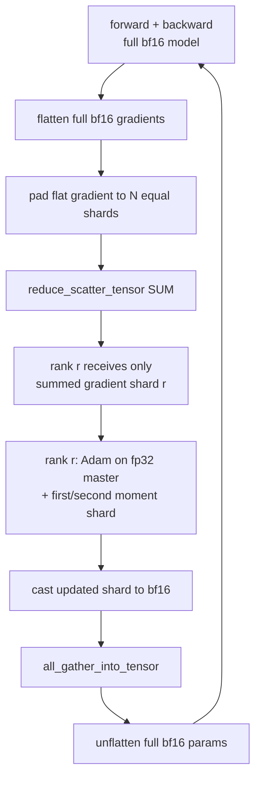

# ZeRO Stage 1 Optimizer State Sharding

Adam keeps two fp32 moment estimates per parameter, so a mixed-precision 7B
model carries 56 GB of moments plus a 28 GB fp32 master copy. ZeRO stage 1
shards those three optimizer tensors across data-parallel ranks: each rank owns
one contiguous 1/N shard, reduce-scatters the full gradient to receive only its
shard's sum, applies Adam locally, and all-gathers the updated compute-dtype
parameter shards so every rank has the full model for the next forward pass.
The parameter and gradient copies stay replicated; only the optimizer state is
sharded. Communication bandwidth is the same as DDP: one reduce-scatter plus
one all-gather is a ring all-reduce split in two.

The spec is the [AI Engineering From Scratch ZeRO capstone](https://aiengineeringfromscratch.com/learn/capstone-projects/zero-parameter-sharding).
This implementation trains a 3-layer MLP for 20 steps on real CPU gloo ranks
and prints per-step loss, measured resident tensor bytes, the stage 1/2/3
projection, and communication accounting.

## What is real / what is simulated

Real:

- four OS processes joined by a file rendezvous and the gloo backend;
- real `torch.distributed.reduce_scatter_tensor` and
  `all_gather_into_tensor` calls moving real tensors;
- real PyTorch autograd and a hand-written bias-corrected Adam step;
- real bf16 forward/backward on CPU with fp32 master weights and moments;
- a single-process reference that runs the same per-rank microbatches and
  compares parameters and losses step by step.

Limited or simulated:

- CPU gloo rather than NCCL/GPU or multi-node;
- bf16 rather than fp16 for the 2-byte compute dtype (same byte budget, no
  loss-scaling/overflow on CPU);
- logical tensor-byte accounting rather than `max_memory_allocated` or a
  CUDA allocator trace;
- stage 2/3 are printed as formulas, not implemented;
- sharded checkpointing, gradient clipping, and communication/compute overlap
  are not implemented.

No paid API, external service, dataset download, or network call is involved
in the demo or tests.

## Architecture



Each rank's local loss is the mean over its micro-batch. `reduce_scatter`
sums those means; dividing the shard by `world_size` turns the sum into the
global mean gradient. The demo requires `batch_size % world_size == 0`, so the
mean is exact rather than weighted by unequal local batch sizes.

## The memory math

Per-parameter bytes per rank for a mixed-precision model with `P` parameters
and `N` ranks. `param_bytes` is the compute dtype (2 for fp16/bf16); the master
and each Adam moment are 4 bytes.

| Stage | What is sharded | Per-rank memory | Per-step communication |
|---|---|---|---|
| DDP | nothing | `16P` | one all-reduce |
| ZeRO-1 | optimizer state | `4P + 12P/N` | one reduce-scatter + one all-gather |
| ZeRO-2 | optimizer + gradients | `2P + 14P/N` | one reduce-scatter + one all-gather |
| ZeRO-3 | optimizer + gradients + parameters | `16P/N` | per-layer all-gathers + reduce-scatters |

At 7B parameters and bf16 compute, the formula projection is:

| Stage | N=8 | N=64 | Drop vs DDP at N=8 | Drop at N=64 |
|---|---:|---:|---:|---:|
| DDP | 104.31 GiB | 104.31 GiB | 0% | 0% |
| ZeRO-1 | 35.86 GiB | 27.30 GiB | 65.6% | 73.8% |
| ZeRO-2 | 24.45 GiB | 14.46 GiB | 76.6% | 86.1% |
| ZeRO-3 | 13.04 GiB | 1.63 GiB | 87.5% | 98.4% |

These are formula projections, not GPU measurements. The implemented demo is
a 1,633-parameter MLP, so its absolute byte counts are tiny; the ratios are the
point.

### Why reduce_scatter, and why stage 1

A ring all-reduce moves `2P(N-1)/N` bytes per rank. A ring reduce-scatter moves
`P(N-1)/N` and a ring all-gather moves `P(N-1)/N`; the pair equals one
all-reduce. Sending the full reduced gradient to every rank with all-reduce and
then using only shard `r` wastes the rest. Reduce-scatter delivers exactly the
shard rank `r` needs, and the later parameter all-gather is required anyway.

Stage 1 is the cheapest large win: optimizer state is 12 of the 16 bytes per
parameter in the mixed-precision budget, and it is touched only during the
step. Stage 2 shards gradients too at the same bandwidth, but requires
gradient-shard accumulation bookkeeping. Stage 3 shards parameters and pays
per-layer all-gathers in every forward and backward; that trade is justified
only when parameter memory itself blocks the model. DeepSpeed stage 1 is this
design; PyTorch FSDP's `SHARD_GRAD_OP` is the stage-2 analogue and `FULL_SHARD`
is stage 3 ([DeepSpeed](https://www.deepspeed.ai/tutorials/zero/),
[FSDP](https://docs.pytorch.org/docs/2.15/fsdp.html)).

The implementation pads the flat vector to `ceil(P/N) * N` so every rank has
equal shards for the collectives. For `P=1633, N=4`, the shard is 409 elements
and the padded vector is 1636: three extra elements, 12 bytes per fp32 state
tensor across all ranks (3 bytes per rank), and 12 extra bytes per rank per
step across the two bf16 collectives.

## Implementation decisions

- **Flat layout.** `flatten_params` concatenates `module.parameters()` in
  registration order into a contiguous 1-D copy; `unflatten_into` copies
  contiguous slices back into the existing `Parameter` objects, preserving
  identity, `requires_grad`, and autograd. `flatten_grads` uses `.grad` and
  zero-fills unused parameters.
- **Ceil shards and tail padding.** `ShardSpec` computes
  `shard_numel = ceil(P/N)`, `padded_numel = shard_numel * N`, and a
  `[start, end)` ownership range. Ranks beyond `P` own an empty logical range
  and a zero shard; this also supports `N > P`.
- **Local mean, then divide.** Each rank backward-passes its local mean loss.
  Reduce-scatter sums those gradients, then the optimizer divides by `N` before
  Adam. The reference accumulates the same local means in fp32.
- **All-gather compute-dtype shards, never the fp32 master.** The fp32 master
  and both moments remain sharded. All-gathering them would double the wire
  bytes and defeat the bandwidth claim. Each rank casts its updated master shard
  to bf16 and the all-gather reconstructs the full bf16 parameter vector.
- **Bias-corrected Adam.** The local update uses
  `m = β₁m + (1-β₁)g`, `v = β₂v + (1-β₂)g²`,
  `denom = sqrt(v)/sqrt(1-β₂ᵗ) + ε`, and
  `master -= (lr/(1-β₁ᵗ)) * m/denom`, matching `torch.optim.Adam`'s algebra.
  The unit test compares it to `torch.optim.Adam(..., foreach=False)` within
  `1e-6`.
- **Single-process path.** `ZeroOptimizer(model, 1, 0, lr)` shards to a single
  full shard and skips all collectives. The tests and the demo's
  `--world-size 1` mode exercise it.
- **Transient buffers are excluded from the table.** Each step materializes a
  full flat gradient and a padded copy, and the all-gather materializes a full
  parameter vector. The reported bytes are persistent parameters, gradients,
  and optimizer shards at the first backward, not allocator peak.
- **Master initialization.** The fp32 master starts as the upcast of the
  compute-dtype parameters; this is a small simplification relative to AMP,
  where the master would start from the original fp32 initialization.

No stage 2/3 implementation, sharded checkpoint manifest, gradient clipping,
bucket fusion, overlap, parameter groups, or scheduler is included.

## Quickstart

Requires Linux, Python 3.14, and [uv](https://docs.astral.sh/uv/). PyTorch is
pinned to the CPU build.

```bash
cd 78-zero-parameter-sharding
uv sync --frozen
uv run python code/main.py
```

The spec's raw command also works after activating the local environment:

```bash
source .venv/bin/activate
python3 code/main.py
```

Expected: a 20-row loss table with every row `PASS`, the measured memory table
showing ZeRO-1 at 11,440 bytes versus DDP's 26,128 bytes, the 7B projection,
the communication table, and `ALL CHECKS PASSED`.

Run the full gate with:

```bash
./verify.sh
```

`verify.sh` synchronizes the frozen environment into the ignored `.venv`,
byte-compiles the sources, and runs the 14-test pytest suite. It is safe to run
twice; every distributed test uses a unique temporary rendezvous directory.

Useful variants:

```bash
# Strong fp32 equivalence: max param delta ~7e-9.
uv run python code/main.py --dtype fp32 --world-size 3 --steps 4 \
  --batch-size 48 --hidden 8

# World size one: no collectives at all.
uv run python code/main.py --world-size 1 --steps 3

# Shorter bf16 run used by the CLI test.
uv run python code/main.py --steps 2 --world-size 2 --hidden 6 --batch-size 16
```

## Measured results

Measured locally on a 12-vCPU x86_64 Linux host, Python 3.14.10, PyTorch
2.15.0+cpu, gloo, four spawned ranks. The host line from the captured run:

```text
torch=2.15.0+cpu python=3.14.10 cpus=12 platform=Linux-7.3.5-2-cachyos-x86_64-with-glibc2.44
```

### Correctness, 20 steps, four bf16 ranks

```text
step  zero_loss   ref_loss     dloss      zero_sum       ref_sum       dsum   max|dw| replicas result
--------------------------------------------------------------------------------------------------------
   0   1.427734   1.427734  0.00e+00    1.72580338    1.72580338   0.00e+00  0.00e+00    exact PASS
   1   1.735352   1.735352  0.00e+00    2.47927570    2.48259068  -3.31e-03  9.77e-04    exact PASS
   2   1.527344   1.527344  0.00e+00    2.35982132    2.35215664   7.66e-03  2.44e-03    exact PASS
   3   1.534180   1.534180  0.00e+00    3.24961329    3.24671143   2.90e-03  4.64e-03    exact PASS
   4   1.632812   1.630859  1.95e-03    4.50955534    4.48824501   2.13e-02  6.35e-03    exact PASS
   5   1.027344   1.027344  0.00e+00    6.09273624    6.05654812   3.62e-02  8.30e-03    exact PASS
   6   0.754395   0.754395  0.00e+00    7.84391809    7.77434492   6.96e-02  1.03e-02    exact PASS
   7   1.056641   1.057617  9.77e-04   10.04552078    9.98468208   6.08e-02  1.27e-02    exact PASS
   8   0.528809   0.528320  4.88e-04   12.38873911   12.35540891   3.33e-02  1.37e-02    exact PASS
   9   0.566406   0.567383  9.77e-04   14.78591251   14.74921024   3.67e-02  1.51e-02    exact PASS
  10   0.474121   0.473633  4.88e-04   17.24138641   17.18766582   5.37e-02  1.56e-02    exact PASS
  11   0.234863   0.234619  2.44e-04   19.39533329   19.33045006   6.49e-02  1.66e-02    exact PASS
  12   0.133789   0.133240  5.49e-04   21.06673229   21.01218367   5.45e-02  1.76e-02    exact PASS
  13   0.125366   0.124146  1.22e-03   22.65703964   22.60883331   4.82e-02  1.95e-02    exact PASS
  14   0.224121   0.223633  4.88e-04   23.57078838   23.53225899   3.85e-02  2.20e-02    exact PASS
  15   0.216309   0.215820  4.88e-04   23.71785641   23.69279194   2.51e-02  2.34e-02    exact PASS
  16   0.370605   0.372070  1.46e-03   22.86249828   22.86729813  -4.80e-03  2.49e-02    exact PASS
  17   0.246216   0.246826  6.10e-04   21.66388875   21.69853735  -3.46e-02  2.64e-02    exact PASS
  18   0.156616   0.155518  1.10e-03   20.30677223   20.36347389  -5.67e-02  2.73e-02    exact PASS
  19   0.146484   0.145386  1.10e-03   18.84673500   18.92514896  -7.84e-02  2.93e-02    exact PASS
```

`max|dw|` is the largest absolute parameter difference between any rank and
the single-process reference. All four ranks are byte-identical at every step
(`replicas exact`). The bf16 run's final max parameter delta is `2.93e-02`,
inside the `5e-02` quantization/reduction allowance, with a max loss delta of
`1.953e-03`. The fp32 run (`--dtype fp32 --world-size 3 --steps 4
--batch-size 48 --hidden 8`) measured max loss delta `0.0` and max parameter
delta `7.451e-09`. The fp32 check is the algorithmic gate; bf16 drift comes
from summing bf16 gradients and casting the parameter shard.

### Measured memory, first backward

```text
component               DDP       ZeRO-1
----------------------------------------
params                3,266        3,266
grads                 3,266        3,266
master fp32           6,532        1,636
moment1 fp32          6,532        1,636
moment2 fp32          6,532        1,636
total                26,128       11,440
measured optimizer state: 4,908 bytes (expected 4,908)
total saving vs DDP: 56.2%
```

The optimizer state alone drops from 19,596 bytes to 4,908 bytes, a 75.0%
reduction at `N=4`. Parameters and gradients remain replicated; that is the
stage-1 trade.

### Projected 7B memory

```text
stage      N        GiB   vs DDP
--------------------------------
DDP        8     104.31    1.00x
ZeRO-1     8      35.86    2.91x
ZeRO-2     8      24.45    4.27x
ZeRO-3     8      13.04    8.00x
DDP       64     104.31    1.00x
ZeRO-1    64      27.30    3.82x
ZeRO-2    64      14.46    7.21x
ZeRO-3    64       1.63   64.00x
```

### Communication

```text
reduce_scatter calls=20 bytes=65,440 (3,272/step)
allgather calls=20 bytes=65,440 (3,272/step)
ZeRO payload/step=6,544 ideal=6,544 padding overhead=12
DDP allreduce payload/step=6,532
ring bandwidth/rank/step: ZeRO=4,908 DDP=4,899
```

The 12-byte payload difference is the three padding elements in the 1,636-long
bf16 vector (`3 * 2 * 2` bytes across the two collectives). The ring bandwidth
difference is 9 bytes per rank per step. Ignoring padding, reduce-scatter +
all-gather equals the DDP all-reduce.

### Timing and tests

```text
reference_s=0.022 train_s=0.062 wall_s=3.730
14 passed in 7.72s
```

These are host-specific CPU gloo timings for a 1,633-parameter MLP. They are
not throughput or GPU claims.

## What runs offline / optional real GPU mode

Everything after `uv sync --frozen` runs offline:

- the rendezvous is a `FileStore` in a unique local temporary directory;
- gloo uses loopback transport between local OS processes;
- tests make no external network calls and require no GPU, cloud sandbox,
  paid API, or remote host.

The only network access in the workflow is dependency synchronization, which
downloads the pinned CPU wheels.

The CLI accepts `--device cuda --backend nccl`. In that mode the worker selects
`cuda:{rank}`, initializes NCCL, and moves the model and batches to the device;
the algorithm is unchanged. The pinned CPU wheel has no CUDA runtime, so this
path is not exercised and no GPU or NCCL numbers are claimed. A multi-node run
would replace the local file rendezvous with a shared filesystem or TCP store;
the flat layout, collectives, and tests would not change.

## Limitations

- **Stage 1 only.** Stage 2/3 appear as formulas. Sharding gradients requires
  shard-local accumulation; sharding parameters requires per-layer
  all-gathers in forward and backward.
- **No sharded checkpointing.** The optimizer state is split across ranks and
  is not saved with an ownership manifest. A restart would need consolidation
  or the lesson-80 checkpoint format.
- **No gradient clipping.** Exercise 4 would require an all-reduce of local
  squared norms if gradients are clipped after reduction; this module clips
  nothing.
- **No overlap or bucketing.** Reduce-scatter and all-gather run synchronously
  after backward. Production ZeRO overlaps them with backward and buckets the
  flat buffers.
- **No parameter groups or scheduler.** One learning rate, one betas pair, one
  eps, and one optional L2 weight decay apply to the whole shard.
- **Transient memory is not in the table.** A full flat gradient, padded copy,
  and full all-gather output are allocated per step. The table reports
  persistent tensors at the first backward, not allocator peak.
- **CPU-only measurements.** gloo CPU performance is not an NCCL or
  multi-node result.
- **bf16 drift.** The bf16 run differs from the fp32 reference at
  `2.93e-02` max parameter delta after 20 steps because bf16 gradients are
  reduced in bf16. The fp32 test at `1e-5` is the algorithmic gate.
- **Master initialization.** The fp32 master starts from the compute-dtype
  parameters rather than an original fp32 initialization.
- **No DDP training baseline.** The memory comparison uses the same explicit
  master layout and a formula DDP baseline; it does not time a real
  `DistributedDataParallel` run.
- **Not the spec's optional exercises.** ZeRO-2, a CUDA memory profiler,
  overlap timing, gradient clipping, and allreduce-vs-reduce_scatter wire
  timing are not implemented.

## References

1. AI Engineering From Scratch, [ZeRO Optimizer State Sharding capstone](https://aiengineeringfromscratch.com/learn/capstone-projects/zero-parameter-sharding).
2. S. Rajbhandari, J. Rasley, O. Ruwase, and Y. He, [ZeRO: Memory Optimizations Toward Training Trillion Parameter Models](https://arxiv.org/abs/1910.02054), 2019.
3. DeepSpeed, [Zero Redundancy Optimizer tutorial](https://www.deepspeed.ai/tutorials/zero/).
4. PyTorch, [Distributed communication package (2.15)](https://docs.pytorch.org/docs/2.15/distributed.html) — gloo backend support and `reduce_scatter_tensor` / `all_gather_into_tensor`.
5. PyTorch, [FullyShardedDataParallel (2.15)](https://docs.pytorch.org/docs/2.15/fsdp.html) — sharding strategies and the stage-3 mapping.
