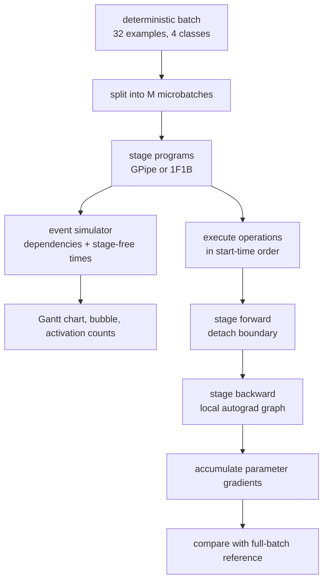

# Pipeline Parallel and Bubble Analysis

Pipeline parallelism cuts a sequential model by depth: rank 0 holds the first
stage, rank 1 the next, and so on. A batch is split into microbatches so
different stages can work on different slices at once. The pipeline still has
empty slots at the start while the first microbatch fills the stages and at the
end while the last microbatch drains. That idle time is the **bubble**.

This module implements the full mechanism on CPU:

- a real `nn.Module` stage that owns a contiguous slice of an 8-layer
  classifier;
- a GPipe schedule (`M` forwards, then `M` backwards) and a non-interleaved
  1F1B schedule (warm up, then one forward/one backward, then drain);
- a deterministic event simulator that records every stage/microbatch
  operation, measures the bubble, and counts activation high-watermarks;
- a real stagewise executor: activations are detached at stage boundaries, each
  backward is local to one stage, and parameter gradients accumulate across
  microbatches;
- a full-batch reference that proves the accumulated pipeline gradients match
  a normal forward/backward;
- a parameter-count vs FLOP-count stage-balance study;
- a zero-buffer handoff model showing why even ranks send first and odd ranks
  receive first.

The capstone specification is the
[AI Engineering From Scratch pipeline-parallel project](https://aiengineeringfromscratch.com/learn/capstone-projects/pipeline-parallel).

## What is real / what is simulated

Real:

- eight parameterized PyTorch layer units split into four contiguous stages
  (`code/main.py` builds the model; the default is hidden size 16);
- real microbatches, real `nn.Module` forward calls, real `F.cross_entropy`;
- real stagewise backward: the input to each stage is detached and made a leaf,
  `torch.autograd.backward` runs only that stage's graph, and the input
  gradient is passed to the previous stage;
- real gradient accumulation and a deep-copied full-batch reference compared
  parameter by parameter;
- real GPipe and 1F1B execution orders: `Pipeline.step` runs operations in the
  simulated start-time order, not just all-forward/all-backward;
- deterministic CPU execution with a fixed seed and a local generator for the
  data.

Simulated or limited:

- **wall-clock time.** Stage cycles are abstract units (`1.0` in the demo), not
  measured GPU or CPU durations. The Gantt chart and makespan come from the
  event simulator. The real tensor work still runs; it is not timed.
- **ranks.** All stages live in one Python process. There is no
  `torch.distributed` process group, no NCCL/gloo send/recv, and no network.
- **handoffs.** Moving an activation from stage `s` to `s + 1` is assumed to be
  zero-cost and instantaneous. Communication is not in the timeline.
- **activation memory.** The reported high-watermark is a count of microbatch
  boundary activations retained per stage. It is not an allocator peak and does
  not include every tensor saved inside a stage's autograd graph.
- **stage balance.** FLOPs and parameter counts are analytic formulas for a toy
  transformer, not hardware counters or profiler traces.
- **Scope.** Non-interleaved 1F1B only (one model chunk per rank). Megatron's
  multi-chunk interleaved schedule, activation checkpointing, optimizer
  convergence, and real multi-node execution are not implemented. PyTorch's
  `torch.distributed.pipeline.sync.Pipe` is deprecated and absent from the
  pinned torch 2.15 CPU build, so the schedule and executor are implemented
  directly rather than wrapping it.

No paid API, external service, dataset download, or network call is involved
in the demo or tests. `uv sync` is the only network-using step.

## Architecture



`code/main.py` is the implementation and the spec's runnable entry point.
`pipeline_parallel/main.py` loads it as `pipeline_parallel.main` for tests; this
avoids a top-level `code` package that would shadow the Python standard
library's `code` module.

### Schedule model

For each stage the simulator has a fixed forward/backward program. An operation
can start only when its data dependencies are complete, and only one operation
runs on a stage at a time:

- forward `(s, m)` depends on forward `(s-1, m)`;
- backward `(s, m)` depends on forward `(s, m)` and, unless `s` is the last
  stage, backward `(s+1, m)`.

GPipe's program is all `M` forwards followed by all `M` backwards. The 1F1B
program for stage `s` is:

```text
w = min(N - s, M)
F(0) ... F(w-1)
for i in 0 .. M-w-1:  B(i), F(w+i)
for i in M-w .. M-1:  B(i)
```

Stage 0 therefore warms up `N` microbatches (or `M` when `M < N`), and the last
stage alternates from its first backward. Both programs contain exactly `M`
forwards and `M` backwards per stage.

The executor consumes the event trace sorted by start time. For a forward it
detaches the incoming activation, makes it a leaf, and runs the stage. For a
backward it calls `torch.autograd.backward` on that stage's output with the
gradient received from the next stage; the stage input's `.grad` is the
gradient passed upstream. Every microbatch's raw loss is divided by `M` before
backward, so summing the microbatches gives the mean gradient over the effective
batch `M * B`.

## Bubble math

With unit forward and backward times, each stage has `2M` useful cycles. The
fill and drain each cost `N-1` cycles, so the per-stage idle time is `2(N-1)` and
the stage's total timeline is `2(M + N - 1)`. The spec defines the bubble
fraction as idle over useful-plus-idle:

\[
\text{bubble fraction} = \frac{2(N-1)}{2(M+N-1)} = \frac{N-1}{M+N-1}.
\]

At `N=4, M=8` that is `3/11 = 27.27%`; at `M=64` it is `3/67 = 4.48%`. The
measured traces reproduce these values exactly for both schedules.

Megatron's write-up reports a different denominator, bubble over **ideal
compute time**: `(p-1)/m`. At `N=4, M=8` that is `37.50%`. Both numbers describe
the same six idle cycles per stage; only the denominator differs. This module
implements the spec's `(N-1)/(M+N-1)` in `bubble_fraction` and states the
distinction here rather than silently mixing the two conventions.

## GPipe versus 1F1B

At equal stage costs both schedules have the same makespan and bubble. The
difference is memory:

- GPipe retains up to `M` microbatch activations per stage because every
  forward happens before any backward.
- 1F1B retains at most `N` (or `M` when `M < N`) because it starts a backward
  as soon as the corresponding gradient arrives.

For `N=4, M=8` the measured per-stage high-watermarks are `(8,8,8,8)` for GPipe
and `(4,3,2,1)` for 1F1B. At `M=64`, GPipe peaks at 64 while 1F1B stays at 4.
This is the reason production pipelines use 1F1B: the bubble is unchanged, but
activation memory no longer grows with the number of microbatches.

The 1F1B here is **non-interleaved**: one contiguous model chunk per rank. The
Megatron interleaved schedule gives each rank multiple chunks and reduces the
bubble by roughly the number of chunks per rank, at the cost of extra
point-to-point communication. That variant is out of scope.

## Stage balance: compute, not parameter count

The balance demo uses 12 transformer-style blocks plus an embedding and a
classifier head:

- embedding: `vocab * d` parameters, zero modeled lookup FLOPs;
- each block: `12 d^2` parameters and `24 d^2 * seq` forward FLOPs;
- head: `d * classes` parameters and `2 d * classes * seq` FLOPs.

With `d=256`, `seq=64`, `vocab=16384`, and 256 classes, the two contiguous
partitions are:

| axis | stages (layer counts) | stage FLOPs | compute utilization | simulated makespan, M=8 |
|---|---|---|---:|---:|
| params | 1, 4, 4, 5 | 0, 402.7M, 402.7M, 411.0M | 73.98% | 81.33 block-cycles |
| FLOPs | 4, 3, 3, 4 | 302.0M, 302.0M, 302.0M, 310.4M | 97.97% | 67.33 block-cycles |

`partition_even` minimizes the sum of squared stage totals over contiguous
splits. Equal parameter count puts the embedding alone (many weights, no
compute) and packs the blocks into the remaining stages. Equal FLOPs gives the
embedding stage extra blocks and the head stage fewer, producing uneven
parameter counts but a much shorter simulated pipeline: `1.21x` faster in
block-forward units. The point is not that parameters are irrelevant; it is
that the pipeline gate is the slowest stage's **compute**, and the slowest
stage determines the makespan.

These are analytic FLOP-time units, not seconds and not GPU throughput.
Production teams should profile the real per-layer wall-clock on the target
hardware before assigning layers; this demo uses formulas so the result is
deterministic and testable on a laptop.

## Deadlock-free handoff

A zero-buffer point-to-point exchange can deadlock if both ranks send before
either receives. The standard ordering is:

- even ranks: `send`, then `recv`;
- odd ranks: `recv`, then `send`.

`exchange_order(rank)` returns that program, and `simulate_exchange` models the
rendezvous: two send-first programs deadlock with zero steps; an even/odd pair
completes both handoffs in two steps. Real NCCL/gloo transports may buffer more
than zero messages, but the ordering rule removes the dependency on buffering.

## Offline boundary and GPU mode

`uv sync --frozen` downloads the pinned CPU wheels once. After that, the demo
and the entire pytest suite run offline: there is no network call, paid API,
external service, cloud sandbox, or dataset download in the execution path or
the tests.

No GPU mode is implemented or claimed. The model and executor use ordinary
PyTorch tensors, so moving them to CUDA is mechanically possible, but this
module has no CUDA/NCCL tests and reports only CPU measurements. A real
multi-GPU pipeline would also need to replace the zero-cost handoff model with
`torch.distributed` send/recv and pin each stage to a device; the schedule and
bubble logic would remain the same.

## Quickstart

Requires Linux, Python 3.14, and [uv](https://docs.astral.sh/uv/). PyTorch is
pinned to the CPU build.

```bash
cd 79-pipeline-parallel
uv sync --frozen
uv run python code/main.py
```

The spec's raw command works after activating the local environment:

```bash
source .venv/bin/activate
python3 code/main.py
```

Expected: two `PASS` correctness lines, GPipe and 1F1B Gantt charts, the bubble
table, the activation high-watermark table, the stage-balance table, the
handoff line, and `ALL CHECKS PASSED`.

Run the full gate with:

```bash
./verify.sh
```

`verify.sh` synchronizes the frozen environment into the ignored `.venv`,
byte-compiles the sources, runs the demo without Gantt output, and runs the
15-test pytest suite. It is safe to run twice.

Useful variants:

```bash
# Smaller batch/stage run used by the CLI test.
uv run python code/main.py --microbatches 4 --batch-size 16 --hidden 8 --no-gantt

# Two stages and more microbatches.
uv run python code/main.py --stages 2 --microbatches 16

# One stage: no pipeline bubble, useful as a control.
uv run python code/main.py --stages 1 --microbatches 8
```

`--stages` accepts `1, 2, 4, 8`; the 8-layer model splits evenly. The batch
size must be divisible by the microbatch count.

## Measured results

Measured locally in the provided Linux x86_64 environment. The captured
environment line was:

```text
torch=2.15.0+cpu python=3.14.10 cpus=1 platform=Linux-7.3.5-2-cachyos-x86_64-with-glibc2.44
```

`cpus=1` is the PyTorch intra-op thread count set by the demo, not the host's
physical CPU count.

### Correctness, one step per schedule

```text
gpipe  loss=1.386218 ref=1.386218 dloss=2.98e-08 max|dw|=3.73e-09 PASS
1f1b   loss=1.386218 ref=1.386218 dloss=2.98e-08 max|dw|=3.73e-09 PASS
```

Both schedules accumulate gradients that match the full-batch reference to
float32 noise. The tests repeat the comparison in `float64` and require loss
and gradient agreement within `1e-10` and `1e-9` respectively. The implementation
also scales each microbatch's mean loss by `1/M`; without that scaling the
accumulated gradient is `M` times too large.

### Gantt charts, `N=4, M=8`

```text
gpipe Gantt: F<mb> forward, B<mb> backward, . idle
          00112233445566778899001122334455667788990011
stage 0 | F0F1F2F3F4F5F6F7............B7B6B5B4B3B2B1B0
stage 1 | ..F0F1F2F3F4F5F6F7........B7B6B5B4B3B2B1B0..
stage 2 | ....F0F1F2F3F4F5F6F7....B7B6B5B4B3B2B1B0....
stage 3 | ......F0F1F2F3F4F5F6F7B7B6B5B4B3B2B1B0......

1f1b Gantt: F<mb> forward, B<mb> backward, . idle
          00112233445566778899001122334455667788990011
stage 0 | F0F1F2F3......B0F4B1F5B2F6B3F7B4..B5..B6..B7
stage 1 | ..F0F1F2....B0F3B1F4B2F5B3F6B4F7B5..B6..B7..
stage 2 | ....F0F1..B0F2B1F3B2F4B3F5B4F6B5F7B6..B7....
stage 3 | ......F0B0F1B1F2B2F3B3F4B4F5B5F6B6F7B7......
```

Each stage has exactly 16 busy cycles and 6 idle cycles, so the measured bubble
is `6 / 22 = 27.27%` for both schedules. The 1F1B chart shows drain gaps where a
stage waits for the upstream backward of a later microbatch; it still completes
in the same 22 cycles.

### Bubble fraction versus the closed form

```text
bubble fraction, N=4 (idle / (useful + idle))
M      closed      GPipe      1F1B
------------------------------------
2         60.00%      60.00%      60.00%
4         42.86%      42.86%      42.86%
8         27.27%      27.27%      27.27%
16        15.79%      15.79%      15.79%
32         8.57%       8.57%       8.57%
64         4.48%       4.48%       4.48%
```

The measured values agree with `(N-1)/(M+N-1)` to within `1e-9` for every row.

### Activation high-watermark, `N=4, M=8`

```text
stage    GPipe    1F1B
-----------------------
0             8       4
1             8       3
2             8       2
3             8       1
peak          8       4
```

GPipe retains every forwarded microbatch until its backward. 1F1B retains at
most the pipeline depth. At `M=64`, the corresponding peaks are 64 and 4.

### Stage balance

```text
stage balance, 4 stages, 12 blocks + embedding + head
axis   stage layers       params        flops  flops/max
-----------------------------------------------------------
params 0     1         4,194,304             0     0.00%
params 1     4         3,145,728   402,653,184    97.96%
params 2     4         3,145,728   402,653,184    97.96%
params 3     5         3,211,264   411,041,792   100.00%
params total  14       13,697,024 1,216,348,160 compute utilization 73.98%
flops  0     4         6,553,600   301,989,888    97.30%
flops  1     3         2,359,296   301,989,888    97.30%
flops  2     3         2,359,296   301,989,888    97.30%
flops  3     4         2,424,832   310,378,496   100.00%
flops  total  14       13,697,024 1,216,348,160 compute utilization 97.97%
simulated makespan, M=8, cycles in block-forward units: params=81.33 flops=67.33 (1.21x)
```

The parameter-balanced partition has almost identical parameter counts
(4.19M/3.15M/3.15M/3.21M) but a stage with zero compute and a nearly 1.21x
longer simulated pipeline. The FLOP-balanced partition has uneven parameter
counts (6.55M/2.36M/2.36M/2.42M) and a 97.97% compute utilization.

### Handoff

```text
handoff: even ranks send-first, odd ranks recv-first; alternating completed=True steps=2; both-send-first completed=False steps=0
```

### Tests and verification

```text
15 passed in 1.34s
```

`./verify.sh` exited 0 twice in a row. The suite covers the closed-form bubble,
both schedule orders, dependency and stage-exclusivity invariants, GPipe and
1F1B gradient equality, activation high-watermarks, microbatch validation,
partition optimality, balance makespan, deadlock ordering, and the CLI. Timings
are host-specific and are not throughput claims.

## Limitations

- **Single process.** This is a schedule and execution study, not a distributed
  run. There is no `torch.distributed` process group, point-to-point transport,
  NCCL, gloo, or multi-node rendezvous.
- **Zero-cost handoffs.** The event model charges nothing for activation
  transfer. A real pipeline with slow interconnects can be communication-bound.
- **Abstract stage time.** The demo uses one cycle per stage operation. The
  balance table uses analytic FLOPs as cycles. Neither is a hardware
  measurement.
- **Non-interleaved 1F1B only.** Multi-chunk interleaving, the deeper Megatron
  variant that reduces the bubble further, is not implemented.
- **No activation checkpointing.** GPipe's activation footprint is reported but
  recomputation is not paired with it.
- **Boundary memory only.** The high-watermark counts stage-input/output
  activations, not every saved tensor inside each stage's autograd graph.
- **One optimization step.** The demo proves gradient equality; it does not
  train to convergence or tune a learning rate.
- **Toy model.** Eight layer units, hidden size 16, four classes, and small
  microbatches. The ratios illustrate the mechanism; they are not LLM
  benchmarking results.
- **CPU only.** The executor is device-agnostic in principle, but no CUDA,
  NCCL, or GPU path is exercised or claimed.
- **Simplified deadlock model.** `simulate_exchange` models a zero-buffer
  rendezvous between two ranks. Real transports can buffer messages; the
  even/odd ordering is still the standard safe pattern.

## References

1. AI Engineering From Scratch, [Pipeline Parallel and Bubble Analysis capstone](https://aiengineeringfromscratch.com/learn/capstone-projects/pipeline-parallel).
2. Y. Huang et al., [GPipe: Efficient Training of Giant Neural Networks using Pipeline Parallelism](https://arxiv.org/abs/1811.06965), 2018.
3. D. Narayanan et al., [Efficient Large-Scale Language Model Training on GPU Clusters Using Megatron-LM](https://arxiv.org/abs/2104.04473), 2021.
4. NVIDIA, [Scaling Language Model Training to a Trillion Parameters Using Megatron](https://developer.nvidia.com/blog/scaling-language-model-training-to-a-trillion-parameters-using-megatron) — 1F1B warm-up/drain, the in-flight activation bound, interleaved schedules, and the bubble formula denominator.
5. D. Narayanan et al., [Memory-Efficient Pipeline-Parallel DNN Training](https://arxiv.org/abs/2006.09503), 2020 — PipeDream-Flush / 1F1B scheduling context.
