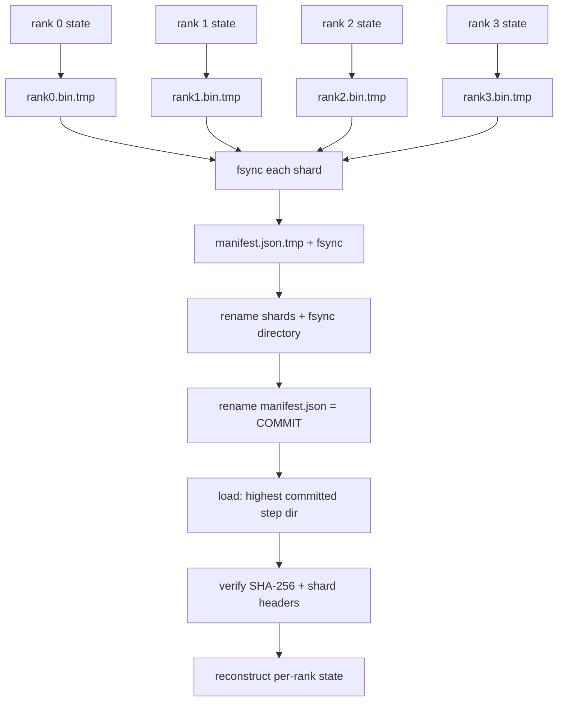

# Sharded Checkpoint and Atomic Resume

A 70B training job writes 1.1 TB of parameters and Adam state. Gathering that through rank 0 makes the checkpoint's speed the slowest single port in the cluster. This module implements the sharded alternative: every rank writes its own contiguous shard, the manifest records which rank owns which byte range, and resume verifies every shard before the optimizer takes another step.

The implementation is the full local mechanism, not a simulation of a file format: real little-endian IEEE-754 fp16 parameters, real fp32 ZeRO/Adam state, real SHA-256, real `fsync` and atomic `rename`, and a deterministic Adam continuation that is byte-equal to an uninterrupted run. The four ranks are logical ranks in one process; they write four independent files through a thread pool rather than through four GPUs and NCCL.

## What is real / what is simulated

Real:

- per-rank binary shards on a local filesystem, each written to `<name>.tmp`, fsynced, and renamed;
- a separate JSON manifest, written to `manifest.json.tmp`, fsynced, and renamed last as the commit point;
- SHA-256 verification of every shard on load, before payload parsing;
- actual IEEE-754 binary16 parameter bytes and `array('f')` fp32 master/Adam arrays;
- exact Adam resume from the loaded optimizer state, checked against an uninterrupted 8-step run;
- failure injection at the manifest rename and tests for world-size, missing/extra-shard, truncated, bit-flipped, mislabeled, and path-traversal inputs;
- optional rotation that keeps the last K committed step directories.

Simulated or scoped down:

- four logical ranks in one process, not four distributed OS processes, GPUs, or NCCL collectives;
- a 1,031-parameter toy state, not a 70B model or a 1.1 TB checkpoint;
- no remote object store, S3 upload, async checkpoint thread, or cross-world-size resharding;
- crash injection at Python call boundaries, not a power-loss hardware test;
- no GPU or 70B throughput measurements.

No network, paid API, external service, dataset download, or GPU is used by the demo or tests. `uv sync` is the only step that may use the network; after the pinned environment exists, the demo and tests run offline.

## Architecture



Checkpoint directory layout:

```text
checkpoints/
└── step-00000003/
    ├── manifest.json
    ├── rank0.bin
    ├── rank1.bin
    ├── rank2.bin
    └── rank3.bin
```

Each checkpoint gets a new step directory. The loader takes the highest-numbered directory that contains a manifest, so there is no mutable `latest` pointer and no second commit point. A crash before the manifest rename leaves the previous step as the highest committed checkpoint.

### Manifest

```json
{
  "world_size": 4,
  "step": 3,
  "wall_clock_seconds": 0,
  "shards": [
    {
      "rank": 0,
      "path": "rank0.bin",
      "sha256": "027c32e52b242e33fbec0fc17eb51626c5e2454e9093b14fce0d3c0c8e2a2c4f",
      "param_shard_offset": 0,
      "param_shard_numel": 258
    }
  ],
  "schema_version": 1
}
```

The manifest in the measured run has four entries; only the first is shown. Validation requires contiguous ranks `0..N-1`, the exact file name `rank{r}.bin`, contiguous `param_shard_offset` ranges with no gaps or overlap, and a lowercase 64-hex SHA-256 for every shard. The shard count must equal `world_size`.

### Shard binary format

All integers and floating-point payloads are little-endian.

| Field | Size | Contents |
|---|---:|---|
| magic | 8 bytes | `SHARD001` |
| header length | 4 bytes | uint32 |
| header | N bytes | UTF-8 JSON: rank, step, offset, numel, Adam step, format version |
| parameters | `2 * numel` | IEEE-754 binary16 |
| fp32 master | `4 * numel` | `array('f')` bytes |
| Adam first moment | `4 * numel` | `array('f')` bytes |
| Adam second moment | `4 * numel` | `array('f')` bytes |

The file size must be exactly `12 + header_length + 14 * numel`. The header repeats the rank, step, offset, and numel recorded in the manifest; a shard copied over another rank's file is rejected even if the manifest hash is updated to match.

## Atomic commit protocol

1. Write every `rank{r}.bin.tmp` in parallel, then flush and `fsync` each file.
2. Serialize the manifest and write `manifest.json.tmp`; flush and `fsync` it.
3. Rename every shard from `.tmp` to its final name; fsync the step directory.
4. Rename `manifest.json.tmp` to `manifest.json`; this is the commit point. fsync the step directory again.
5. Optionally prune old committed step directories, keeping the newest K; fsync the checkpoint root.

POSIX `rename` is atomic for a single name, but a group of renames is not a transaction. The manifest is the only file whose presence makes a checkpoint live, so a crash before step 4 leaves a directory that the loader ignores. A retry of the same step removes only uncommitted `rank*.bin` and `*.tmp` residue, then rewrites the checkpoint. A committed step is never overwritten.

Directory fsyncs are deliberate: `fsync(file)` does not guarantee that the directory entry reached disk. The Linux `fsync(2)` manual calls out the need for a separate directory fsync.

## Failure defenses

| Failure | What the loader does |
|---|---|
| World-size change | `world_size` must equal `expected_world_size`; otherwise `WorldSizeMismatchError` is raised before any shard read. |
| Shard count mismatch | Manifest validation requires one entry per rank, and load enumerates `rank*.bin`; missing or extra files raise `ShardIntegrityError` naming both sets. |
| Partial or corrupted write | The full file SHA-256 is checked before parsing; truncation, bit flips, and trailing bytes fail. |
| Manifest says the wrong shard | Each header's rank, step, offset, and numel must agree with its manifest entry. |
| Path traversal / duplicate rank | Paths must be exactly `rank{r}.bin`, ranks must be contiguous, and offsets must cover a gap-free range. |
| Mixed optimizer state | All shards must report the same Adam step. |
| Uncommitted crash residue | A step directory without a committed manifest is never selected as the live checkpoint. |

## Quickstart

Requires Linux, Python 3.14, and [uv](https://docs.astral.sh/uv/). There are no runtime dependencies; pytest is the only dev dependency.

```bash
cd 80-checkpoint-sharded-resume
uv sync --frozen
uv run python code/main.py
```

The spec's direct command also works because the implementation is stdlib-only:

```bash
python3 code/main.py
```

Expected output includes four shard rows, the manifest summary, and:

```text
byte-equal shards: PASS
resume exact: PASS (max |delta|=0.0)
ALL CHECKS PASSED
```

The default run creates a fresh temporary checkpoint directory and prints its path. Use `--dir` to choose a directory, or change the shape:

```bash
uv run python code/main.py --dir /tmp/checkpoint-demo --world-size 4 \
  --total-numel 1031 --checkpoint-step 3 --resume-steps 5
```

Run the full gate:

```bash
./verify.sh
```

`verify.sh` syncs the frozen environment into the ignored `.venv`, byte-compiles the sources, runs the demo into a temporary directory, and executes the 24-test pytest suite. It is safe to run twice.

```bash
uv run pytest -q
```

## Measured results

Measured locally on a 12-vCPU x86_64 Linux host, Python 3.14.10. File sizes are deterministic for the default 1,031-parameter demo; the timing is a single warm run.

| Artifact | Measured |
|---|---:|
| `rank0.bin` | 3,751 bytes, 258 elements |
| `rank1.bin` | 3,753 bytes, 258 elements |
| `rank2.bin` | 3,753 bytes, 258 elements |
| `rank3.bin` | 3,739 bytes, 257 elements |
| `manifest.json` | 921 bytes |
| Total checkpoint | 15,917 bytes |
| Demo wall time | 0.067 s |
| pytest suite | 24 passed in 0.13 s |

The demo's Adam continuation reports `max |delta| = 0.0` against the uninterrupted 8-step run. These are correctness measurements on a toy state, not 70B throughput or bandwidth claims.

## Design decisions

- **Stdlib-only state encoding.** Python 3.14's `array` has no `'e'` (binary16) typecode; fp16 parameters are packed with `struct` format `e` and explicit little-endian ordering. This keeps the checkpoint format inspectable and avoids a GPU/torch dependency for a format lesson.
- **Manifest last, per-step directories.** The manifest is the only commit marker, and the loader selects the highest committed step directory. No `latest` file can disagree with the manifest.
- **Canonical shard split.** `param_shard_offset` and `param_shard_numel` follow the deterministic split `floor(total/N)` with one extra element on the first `total % N` ranks. Save rejects any other layout; load reconstructs only gap-free ranges.
- **Verify bytes before semantics.** SHA-256 is checked before JSON or payload parsing so corrupted bytes are not interpreted. Header fields then check the manifest's ownership claims.
- **Rotation after commit.** `keep_last` prunes only committed step directories after the new manifest lands. The live checkpoint is never deleted to make room for an unfinished one.
- **Threaded writers, clear boundary.** The thread pool makes four independent file writes overlap on a local filesystem; it is not a distributed collective and the README labels it as such.
- **Loaded arrays are live views.** `LoadedCheckpoint.state_dicts()` exposes the same mutable arrays held by `ranks`; callers that need an immutable snapshot should copy them. A fresh `load_sharded` call never aliases a previous load's arrays.

## Optional real GPU / provider mode

No GPU or hosted-provider path is included or measured. The format is transport-agnostic: a real `torch.distributed` job can call the same writer on each rank against a shared filesystem, with the coordinator publishing the manifest last. For object storage, upload every shard under its manifest key and commit the manifest object last; loaders must still verify each object's SHA-256. Those integrations, cross-world-size resharding, async checkpointing, and remote upload are not implemented here.

## Limitations

- One process and one writer per checkpoint root; concurrent save/load/rotation is not synchronized.
- Four logical ranks, not distributed processes or GPUs; no NCCL evidence.
- No async write, S3/GCS upload, cross-world-size rebalancing, CRC-only fast path, compression, or encryption.
- Load reads and materializes each shard sequentially, so a shard-sized buffer is resident per rank.
- Atomicity and durability depend on a POSIX local filesystem with working directory fsync; NFS and other network filesystems may differ.
- The 1,031-parameter demo is a correctness fixture, not a performance result for 70B models.
- No hardware power-loss test; crashes are injected at rename and write boundaries.

## References

1. AI Engineering From Scratch, [Sharded Checkpoint and Atomic Resume](https://aiengineeringfromscratch.com/learn/capstone-projects/checkpoint-sharded-resume).
2. PyTorch, [Distributed Checkpoint](https://docs.pytorch.org/docs/2.15/distributed.checkpoint.html) — parallel per-rank saves, multiple files per checkpoint, and load-time resharding.
3. PyTorch, [Distributed Checkpoint: Efficient checkpointing in large-scale jobs](https://pytorch.org/blog/distributed-checkpoint-efficient-checkpointing-in-large-scale-jobs/) — asynchronous and local-storage checkpointing context.
4. The Open Group, [POSIX `rename`](https://pubs.opengroup.org/onlinepubs/9699919799/functions/rename.html) — atomic replacement of a single name.
5. Linux man-pages, [`fsync(2)`](https://man7.org/linux/man-pages/man2/fsync.2.html) — file data durability and the separate directory fsync requirement.
