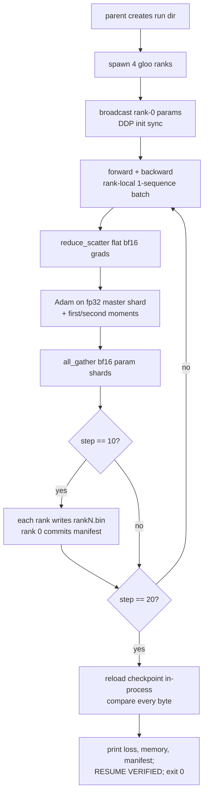

# End-to-End Distributed Training

A capstone composition of four pieces: a 2-layer, 4-head MiniGPT trained for
20 steps by **four spawned CPU ranks** over real gloo collectives, with DDP-style
initial parameter broadcast, ZeRO-1 optimizer-state sharding, and a sharded
checkpoint written at step 10. The run terminates on its own, prints a loss
curve, a per-rank memory profile, and a checkpoint manifest, reloads the
step-10 checkpoint after step 20, and prints `RESUME VERIFIED`.

The four invariants the demo proves:

1. the global mean loss decreases monotonically over the 20 steps within a
   `1e-6` noise tolerance;
2. every rank holds the same parameter norm and SHA-256 at every step;
3. per-rank optimizer memory is exactly `12P/N` bytes
   (`P = 30,144`, `N = 4`, so `90,432` bytes);
4. the step-10 checkpoint reloads byte-equal on the same world size.

## What is real / what is simulated

Real:

- four independent OS processes joined by a local file rendezvous and the
  PyTorch gloo backend;
- real `torch.distributed.reduce_scatter_tensor` and
  `all_gather_into_tensor` calls moving real bf16 tensors;
- real PyTorch autograd through token embeddings, masked multi-head
  self-attention, LayerNorm, GELU MLPs, and an untied LM head;
- real hand-written Adam state on an fp32 shard: master weights plus first and
  second moments, with bias correction;
- real binary shards, SHA-256 manifest, `fsync`, and atomic `rename`; the
  manifest rename is the commit point;
- a real in-process reload that compares every saved parameter, master,
  moment, and Adam-step byte.

Simulated or scoped down:

- CPU gloo instead of NCCL/GPUs or a multi-node cluster;
- four logical ranks inside one host, not four machines;
- a 30,144-parameter model, not a production LLM;
- a fixed four-sequence full batch over an arithmetic synthetic corpus. The
  fixed batch is deliberate: it makes the 20-step monotonicity check
  reproducible instead of measuring dataset noise. It is not a language-
  modeling quality benchmark;
- persistent tensor-byte accounting, not process RSS or a CUDA allocator trace;
- checkpointing at a fixed step rather than every K minutes;
- loading and byte-verifying the checkpoint, not continuing training from it;
- no real GPU/NCCL numbers are claimed.

No paid API, cloud sandbox, external dataset, or network call is used by the
demo or tests. `uv sync --frozen` is the only step that may fetch packages.

## Architecture



### Composition rule: one gradient reduction, not two

`torch.nn.parallel.DistributedDataParallel` normally all-reduces gradients and
also performs an init-time parameter/buffer sync. Stacking it on top of ZeRO-1
would reduce every gradient twice. This capstone uses the composition from the
spec's table:

- `DDPBroadcast` owns the **initial** rank-0 parameter broadcast and the
  reduction of scalar metrics such as loss;
- `Zero1Optimizer` owns **gradient sync** through `reduce_scatter_tensor`, the
  local Adam update, and the `all_gather_into_tensor` that rebuilds the full
  model.

The model has no running buffers; LayerNorm weights are parameters and are
part of the broadcast.

### Why `12P/N`?

A mixed-precision ZeRO-1 rank keeps the full bf16 parameter and gradient
copies, but only `1/N` of the optimizer state:

| Per-rank state | Bytes |
|---|---:|
| bf16 parameters | `2P` |
| bf16 gradients | `2P` |
| fp32 master shard | `4P/N` |
| Adam first moment shard | `4P/N` |
| Adam second moment shard | `4P/N` |
| **optimizer total** | **`12P/N`** |

At `P = 30,144`, `N = 4`: `12 * 30,144 / 4 = 90,432` bytes. The demo measures
that value from the actual tensor allocations and fails if it differs.

## Quickstart

```bash
cd 81-end-to-end-distributed-train
uv sync --frozen --no-progress
uv run python code/main.py
```

The spec's direct command also works after activating the local environment:

```bash
source .venv/bin/activate
python3 code/main.py
```

The demo creates a unique `checkpoints/run-*/` directory so reruns never
overwrite a committed step. Use a temporary root when you do not want to keep
the artifact:

```bash
python3 code/main.py --checkpoint-root /tmp/end-to-end-demo
```

`./verify.sh` installs the pinned environment, runs the full 20-step demo, and
runs the test suite. It is safe to run twice.

### What the default run prints

The important sections are stable for tests:

```text
LOSS CURVE (global mean, 20 steps)
...
MEMORY PROFILE (persistent tensors after step 1 backward)
...
CHECKPOINT MANIFEST
world_size=4 step=10 param_numel=30144 shard_numel=7536 adam_step=10 ...
...
RESUME CHECK
rank0 byte-equal
...
RESUME VERIFIED (4/4 rank shards byte-equal)
ALL CHECKS PASSED
```

## Checkpoint contract

Each rank owns a contiguous shard; rank 0 commits only the manifest:

```text
checkpoints/run-<random>/
└── step-00000010/
    ├── manifest.json      # commit point
    ├── rank0.bin
    ├── rank1.bin
    ├── rank2.bin
    └── rank3.bin
```

Manifest (one shard entry shown; the real manifest has four):

```json
{
  "schema_version": 1,
  "world_size": 4,
  "step": 10,
  "param_numel": 30144,
  "shard_numel": 7536,
  "optimizer_bytes_per_rank": 90432,
  "adam_step": 10,
  "shards": [
    {
      "rank": 0,
      "path": "rank0.bin",
      "sha256": "9d7d22c52fabe3b1620d49a5b1fbbc7b26a181f8c097a7b79e0de77c5f115caf",
      "param_shard_offset": 0,
      "param_shard_numel": 7536
    }
  ]
}
```

Every shard is little-endian:

| Field | Size |
|---|---:|
| magic `SHARD001` | 8 bytes |
| header length | uint32, 4 bytes |
| header JSON | rank, step, offset, numel, Adam step, format version |
| parameters | `2 * numel` IEEE-754 binary16 bytes |
| fp32 master | `4 * numel` bytes |
| Adam first moment | `4 * numel` bytes |
| Adam second moment | `4 * numel` bytes |

The file size must be exactly `12 + header_len + 14 * numel`; trailing bytes
are rejected.

### Commit protocol

1. Every rank writes its own `rank{r}.bin.tmp`, flushes, fsyncs, renames to
   `rank{r}.bin`, and fsyncs the step directory.
2. A barrier ensures all payload files are visible.
3. Every rank packs its `ShardEntry` metadata into a fixed 1 KiB uint8 tensor;
   `all_gather` distributes the metadata. Rank 0 validates ranks, offsets,
   canonical shard lengths, and digests, then writes `manifest.json.tmp`,
   fsyncs, renames it to `manifest.json`, and fsyncs the step directory. That
   rename is the single commit point.
4. A final barrier releases the ranks. The payload is never gathered through
   rank 0.

The loader selects the highest `step-*` directory that contains a manifest, so
a crash before step 3 leaves uncommitted shard files that are ignored. On load
it verifies the complete file set, SHA-256 of each file, the shard header, the
manifest offsets, the common Adam step, and the requested world size before
returning any state.

### Failure defenses covered by tests

| Failure | Result |
|---|---|
| world-size change | `WorldSizeMismatchError` before shard read |
| missing or extra shard | `ShardIntegrityError` naming the set |
| truncated or bit-flipped shard | `ShardIntegrityError` from the SHA-256 check |
| copied/mislabeled shard | header rank disagrees with manifest |
| path traversal | manifest path must be exactly `rank{r}.bin` |
| non-contiguous offsets | `ManifestError` |
| mixed Adam steps | `ShardIntegrityError` |
| uncommitted step directory | ignored; no manifest means no checkpoint |
| altered in-memory snapshot | `ResumeMismatchError` on byte comparison |

## Measured results

Measured locally on a 12-vCPU Linux workstation with Python 3.14 and
`torch==2.15.0+cpu`; no GPU/NCCL numbers are included.

Default `python3 code/main.py`:

- wall time: **2.52 s** for 20 steps, including four process spawns, checkpoint
  I/O, and the resume reload;
- global loss: **3.828125 → 0.286621**; every one of the 19 deltas is negative,
  so the maximum per-step increase is **0.0**;
- loss, parameter SHA-256, and parameter norm: identical across all four ranks
  at all 20 steps (maximum norm delta `0.0`);
- per-rank persistent bytes: parameters **60,288**, gradients **60,288**,
  optimizer **90,432**, total **211,008**; measured optimizer bytes equal
  `12P/N`;
- checkpoint: four shards of **105,629 / 105,632 / 105,633 / 105,633 bytes**
  and a **1,007-byte** manifest, **423,534 bytes** total;
- resume: step 10, `adam_step=10`, four shards, all byte-equal;
- tests: **17 passed in 8.13 s** (`pytest -q`).

These are measured values from the implementation in this directory, not
projected or benchmark claims.

## What runs offline

After `uv sync --frozen` has populated `.venv`:

- the demo and all tests use only local files;
- the process group rendezvous is `file://<run-dir>/rendezvous`;
- checkpoints are written to the local filesystem;
- no external service, paid API, credential, or dataset download is required.

The network is used only when the pinned packages are first installed.

## Optional GPU / real-service mode

The code accepts a single-node multi-GPU shape:

```bash
python3 code/main.py --device cuda --backend nccl --world-size 4
```

That requires four visible CUDA devices and a CUDA-enabled `torch==2.15.0`
build. This repository deliberately pins the CPU wheel
(`pytorch-cpu` index), so the default environment cannot exercise this path.
The CUDA/NCCL path was **not verified on this CPU-only workstation**; do not
treat it as a measured GPU result. Multi-node launch is not implemented:
`mp.spawn` starts local processes, and a real multi-node deployment would need
a shared filesystem and an elastic `torchrun`/cluster launcher.

There is no paid provider adapter in this project. Everything in the required
local path is the real local mechanism.

## Limitations

- **Fixed batch and synthetic corpus.** Four deterministic 16-token windows
  repeat for 20 steps. The model overfits those windows; the demo demonstrates
  composition and invariants, not generalization.
- **One checkpoint at a fixed step.** Production runs checkpoint on a
  wall-clock cadence and rotate the last K commits; this demo saves only step
  10.
- **No resume-to-completion path.** `verify_resume` loads and byte-compares the
  checkpoint in-process. Continuing from step 10 to step 20 is the optional
  exercise, not implemented here.
- **No real GPU measurements.** CPU gloo only. The optional CUDA/NCCL flags are
  unverified on this host.
- **No ZeRO-2/3, pipeline parallelism, activation checkpointing, gradient
  clipping, or overlap/bucketing.** ZeRO-1 is the scope.
- **Logical memory accounting.** The profile sums persistent tensor `nbytes`
  after the first backward; it is not RSS, allocator peak, or communication
  scratch memory.
- **Same world size only.** There is no cross-world-size resharding.
- **No divergence rollback.** A non-finite loss or gradient raises immediately;
  there is no loss-spike detector or previous-checkpoint rollback.
- **No multi-node support.** Four local OS processes share one filesystem.

## References

1. AI Engineering From Scratch, [End-to-End Distributed Training capstone](https://aiengineeringfromscratch.com/learn/capstone-projects/end-to-end-distributed-train).
2. PyTorch 2.15, [DistributedDataParallel](https://docs.pytorch.org/docs/2.15/generated/torch.nn.parallel.DistributedDataParallel.html) — init-time parameter/buffer synchronization and gradient all-reduce semantics.
3. PyTorch 2.15, [Distributed communication package](https://docs.pytorch.org/docs/2.15/distributed.html) — gloo backend, file rendezvous, `reduce_scatter_tensor`, and `all_gather_into_tensor`.
4. DeepSpeed, [Zero Redundancy Optimizer tutorial](https://www.deepspeed.ai/tutorials/zero/) — stage 1 partitions fp32 optimizer states and moments.
5. PyTorch, [Advanced Model Training with Fully Sharded Data Parallel](https://docs.pytorch.org/tutorials/intermediate/FSDP_advanced_tutorial.html) — all-gather parameters and reduce-scatter gradients in a sharded data-parallel composition.
